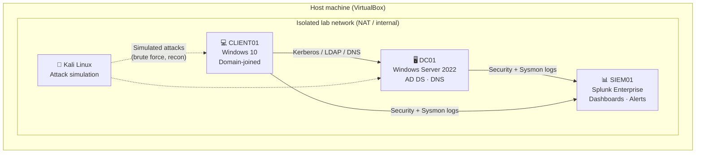

<h1 align="center">🛡️ Cybersecurity Homelabs</h1>

<p align="center">
  Hands-on security labs built in my home environment to practice the skills a SOC analyst uses every day:<br>
  building infrastructure, collecting logs, detecting attacks, and documenting findings.
</p>

<p align="center">
  
  
  
</p>

---

## 📋 Lab index

| # | Lab | Status | Key skills |
|---|-----|--------|-----------|
| 01 | [Active Directory Domain Lab](labs/01-active-directory/) | ✅ Complete | AD DS, DNS, OUs, Group Policy, user lifecycle, PowerShell |
| 02 | [SIEM & Log Monitoring with Splunk](labs/02-siem-log-monitoring/) | ✅ Complete | Splunk, SPL, Sysmon, dashboards, detection rules, alert triage |

*New labs are added using the [lab writeup template](templates/LAB_TEMPLATE.md).*

---

## 🗺️ Lab architecture



Full details: [docs/architecture.md](docs/architecture.md)

---

## 🧰 Tech stack

| Category | Tools |
|----------|-------|
| Virtualization | Oracle VirtualBox |
| Identity | Windows Server 2022, Active Directory Domain Services, Group Policy |
| Endpoints | Windows 10, Sysmon |
| Monitoring | Splunk Enterprise, Splunk Universal Forwarder, SPL |
| Attack simulation | Kali Linux |
| Scripting | PowerShell |

---

## 📁 Repository structure

```
cybersecurity-homelabs/
├── labs/
│   ├── 01-active-directory/      # Writeup, scripts, screenshots
│   └── 02-siem-log-monitoring/   # Writeup, detection queries, screenshots
├── docs/
│   └── architecture.md           # Network layout, VM specs, IP plan
└── templates/
    └── LAB_TEMPLATE.md           # Template used for every new lab
```

---

## 🎯 What each lab demonstrates

Each writeup follows the same format so a reviewer can skim it quickly:

1. **Objective:** what I set out to learn
2. **Environment:** VMs, OS versions, network
3. **Build steps:** how it was configured, with screenshots
4. **Testing / attack simulation:** what I did to prove it works
5. **Findings:** what the logs and alerts showed
6. **Lessons learned:** problems I hit and how I fixed them

---

## ⚠️ Disclaimer

All testing was performed in an isolated lab environment that I own and control. Nothing here is aimed at systems I don't have permission to test.

---

<p align="center">
  📫 <a href="https://www.linkedin.com/in/coreybigby">LinkedIn</a> · <a href="mailto:corey.bigby99@gmail.com">Email</a> · <a href="https://github.com/Corey-Bigby">GitHub profile</a>
</p>
