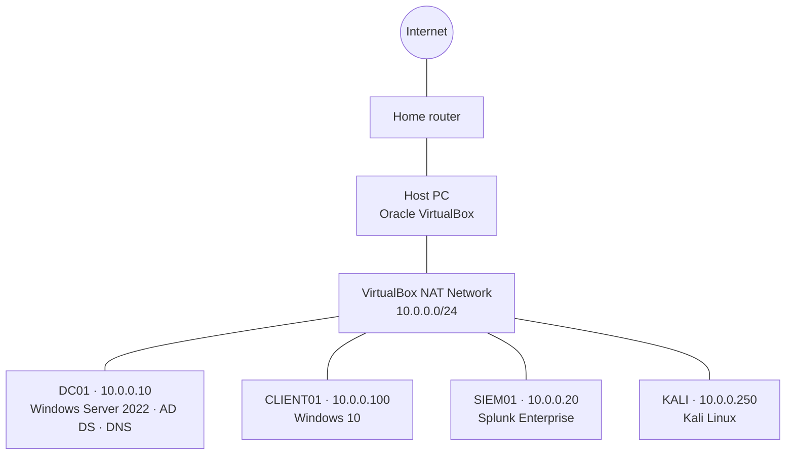

# Lab Architecture

[← Back to lab index](../README.md)

## Network diagram

> Update the IPs and subnet below to match your setup.

## Virtual machines

| Hostname | Role | OS | vCPU | RAM | Disk | IP |
|----------|------|----|------|-----|------|----|
| DC01 | Domain controller, DNS | Windows Server 2022 | 2 | 4 GB | 60 GB | 10.0.0.10 |
| CLIENT01 | Domain-joined workstation | Windows 10 Pro | 2 | 4 GB | 60 GB | 10.0.0.100 |
| SIEM01 | Splunk Enterprise (indexer + search head) | <!-- TODO: Ubuntu Server / Windows --> | 2 | 8 GB | 100 GB | 10.0.0.20 |
| KALI | Attack simulation | Kali Linux | 2 | 4 GB | 40 GB | 10.0.0.250 |

## Domain details

| Setting | Value |
|---------|-------|
| Domain name | `lab.local` <!-- change to yours --> |
| Forest/domain functional level | Windows Server 2016 (highest level available on Server 2022) |
| DNS | DC01 (forwarders → 8.8.8.8 / 1.1.1.1) |

## Isolation and safety

- The lab VMs sit on a VirtualBox NAT Network, separate from my home LAN.
- Attack tools only target lab VMs.
- Snapshots are taken before every major change so I can roll back.
