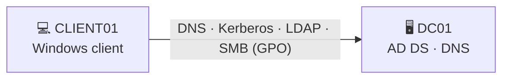

# Lab 01: Active Directory Domain Lab

[← Back to lab index](../../README.md)


<!--
  ✏️ Fill in everything marked with a TODO comment, replace example values with
  what you actually did, and add your own screenshots to ./screenshots/.
  Delete any step you didn't do. Recruiters value accuracy over volume.
-->

## 🎯 Objective

Build a working Windows Active Directory environment from scratch: a domain controller, organized users and groups, Group Policy, and a domain-joined workstation. Most corporate networks run on AD, and it's also the most common thing attackers go after, so a SOC analyst needs to know how it works.

## 🧠 Skills demonstrated

- Installing and promoting a Windows Server domain controller (AD DS + DNS)
- Designing an Organizational Unit (OU) structure
- Creating and managing users and security groups, by hand and in bulk with PowerShell
- Building and applying Group Policy Objects (GPOs) for security hardening
- Joining a Windows client to the domain and checking that policy applies
- Turning on audit policies so security events get logged

## 🖥️ Environment

| Component | Details |
|-----------|---------|
| Hypervisor | Oracle VirtualBox |
| Domain controller | DC01: Windows Server 2022, 10.0.0.10 |
| Client | CLIENT01: Windows 10 Pro, 10.0.0.100 |
| Domain | `lab.local` <!-- TODO --> |
| Network | VirtualBox NAT Network, see [architecture](../../docs/architecture.md) |



## 🔧 Build steps

### 1. Configure the server and set a static IP
Renamed the server to `DC01` and gave it a static IP, with DNS pointing to itself.

```powershell
Rename-Computer -NewName "DC01" -Restart
New-NetIPAddress -InterfaceAlias "Ethernet" -IPAddress 10.0.0.10 -PrefixLength 24 -DefaultGateway 10.0.0.1
Set-DnsClientServerAddress -InterfaceAlias "Ethernet" -ServerAddresses 127.0.0.1
```

<!-- TODO:  -->

### 2. Install AD DS and promote to domain controller

```powershell
Install-WindowsFeature AD-Domain-Services -IncludeManagementTools
Install-ADDSForest -DomainName "lab.local" -InstallDns
```

<!-- TODO:  -->

### 3. Create the OU structure

```
lab.local
├── _Users
│   ├── IT
│   ├── HR
│   └── Sales
├── _Computers
│   └── Workstations
├── _Groups
└── _Admins
```

```powershell
"_Users","_Computers","_Groups","_Admins" | ForEach-Object {
    New-ADOrganizationalUnit -Name $_ -Path "DC=lab,DC=local"
}
"IT","HR","Sales" | ForEach-Object {
    New-ADOrganizationalUnit -Name $_ -Path "OU=_Users,DC=lab,DC=local"
}
```

<!-- TODO:  -->

### 4. Create users and groups (bulk with PowerShell)
Created test users from a CSV and added them to department security groups. Admin accounts are kept apart from everyday user accounts (least privilege).

```powershell
Import-Csv .\users.csv | ForEach-Object {
    New-ADUser -Name "$($_.First) $($_.Last)" `
        -SamAccountName $_.Username `
        -Path "OU=$($_.Dept),OU=_Users,DC=lab,DC=local" `
        -AccountPassword (Read-Host -AsSecureString "Password for $($_.Username)") `
        -Enabled $true
    Add-ADGroupMember -Identity "GRP-$($_.Dept)" -Members $_.Username
}
```

<!-- TODO:  -->

### 5. Create security-focused Group Policy

| GPO | Setting | Why |
|-----|---------|-----|
| Password Policy | Min length 14, complexity on, history 24 | Makes passwords harder to guess or brute force |
| Account Lockout | Lock after 5 failed attempts for 15 min | Slows down brute-force attacks |
| Advanced Audit Policy | Logon/Logoff, Account Logon, Account Management, Process Creation → Success & Failure | Produces the logs used in [Lab 02](../02-siem-log-monitoring/) |
| Disable USB storage | Removable storage: deny all | Stops data theft and malware coming in on USB drives |
<!-- TODO: keep only the GPOs you actually built -->

<!-- TODO:  -->

### 6. Join the client to the domain

```powershell
# On CLIENT01 (DNS pointed at 10.0.0.10)
Add-Computer -DomainName "lab.local" -Credential LAB\Administrator -Restart
```

Checked that the policies applied:

```powershell
gpupdate /force
gpresult /r
```

<!-- TODO:  -->

## 🧪 Testing

- Logged in to CLIENT01 as a domain user ✅
- Entered wrong passwords on purpose to trigger account lockout ✅
- Checked the DC's Security log for Event IDs **4625** (failed logon) and **4740** (account locked out) ✅
<!-- TODO: adjust to what you tested -->

## 🔍 Findings

| Event ID | Meaning | Observed? |
|----------|---------|-----------|
| 4624 | Successful logon | ✅ |
| 4625 | Failed logon | ✅ |
| 4720 | User account created | ✅ |
| 4728 / 4732 | Member added to a security group | ✅ |
| 4740 | Account locked out | ✅ |

These events are forwarded to Splunk in **[Lab 02](../02-siem-log-monitoring/)**.

## 🧩 Challenges & fixes

| Problem | Cause | Fix |
|---------|-------|-----|
| Client couldn't find the domain | Client DNS was pointed at the router, not the DC | Set the client's DNS to 10.0.0.10 |
| <!-- TODO --> | | |

## 📚 Lessons learned

- DNS is the backbone of AD. Most domain-join problems are really DNS problems.
- A clean OU structure makes GPO targeting and delegation simpler.
- Audit policy is off or minimal by default. Without it, a SIEM has nothing useful to collect.

## 🔗 Security+ (SY0-701) connections

- **Domain 4.6:** Identity and access management (directory services, least privilege, password policies)
- **Domain 4.4 / 4.9:** Logging and monitoring, using data sources to support investigations
- **Domain 2.5:** Hardening techniques (GPO-based hardening)

## ⏭️ Next steps

- Simulate common AD attacks (password spraying, Kerberoasting) and detect them in Splunk
- Deploy LAPS for local admin password management
- Add a second domain controller for redundancy
