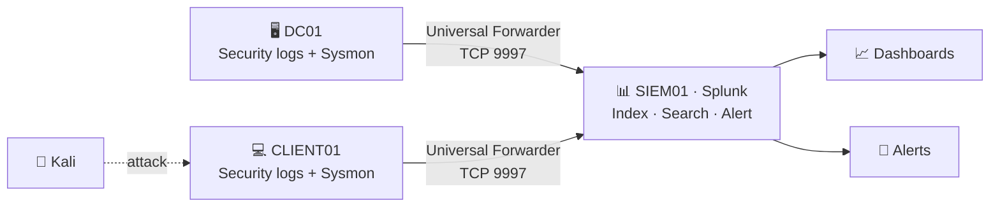

# Lab 02: SIEM & Log Monitoring with Splunk

[← Back to lab index](../../README.md)


<!-- ✏️ Fill in the remaining TODOs and add your own screenshots to ./screenshots/. -->

## 🎯 Objective

Send Windows logs from the [Active Directory lab](../01-active-directory/) into Splunk, build dashboards, and write detection rules that fire on real suspicious activity: brute-force logons, new admin accounts, and suspicious PowerShell.

## 🧠 Skills demonstrated

- Deploying Splunk Enterprise and the Splunk Universal Forwarder on endpoints
- Collecting Windows Security, System, and **Sysmon** logs
- Writing SPL searches and turning them into scheduled alerts
- Building dashboards for at-a-glance monitoring
- Simulating attacks and triaging the alerts they set off

## 🖥️ Environment

| Component | Details |
|-----------|---------|
| Hypervisor | Oracle VirtualBox |
| SIEM | Splunk Enterprise on SIEM01 (10.0.0.20) |
| Log sources | DC01 (Windows Server 2022), CLIENT01 (Windows 10) |
| Agents | Splunk Universal Forwarder + Sysmon <!-- TODO: config used, e.g. SwiftOnSecurity or Olaf Hartong --> |
| Attacker | Kali Linux (10.0.0.250) |



## 🔧 Build steps

### 1. Install Splunk Enterprise
Installed Splunk Enterprise on SIEM01 <!-- TODO: host OS and Splunk version -->, then:
- Opened the web UI on **TCP 8000**
- Turned on receiving under *Settings → Forwarding and receiving → Receive data* on **TCP 9997**
- Created a `windows` index for all endpoint logs
- Installed the **Splunk Add-on for Microsoft Windows** and the **Splunk Add-on for Sysmon** so fields parse correctly

<!-- TODO:  -->

### 2. Install Sysmon on Windows endpoints
Sysmon logs process creation, network connections, and file changes in much more detail than the default Windows logs.

```powershell
.\Sysmon64.exe -accepteula -i sysmonconfig.xml
```

### 3. Install the Universal Forwarder and forward logs
Installed the Splunk Universal Forwarder on DC01 and CLIENT01, pointed it at `10.0.0.20:9997`, and set up `inputs.conf`:

```ini
# C:\Program Files\SplunkUniversalForwarder\etc\system\local\inputs.conf
[WinEventLog://Security]
index = windows
disabled = 0

[WinEventLog://System]
index = windows
disabled = 0

[WinEventLog://Microsoft-Windows-Sysmon/Operational]
index = windows
renderXml = true
disabled = 0

[WinEventLog://Microsoft-Windows-PowerShell/Operational]
index = windows
disabled = 0
```

Checked that both hosts were reporting in:

```spl
index=windows | stats count by host, source
```

<!-- TODO:  -->

### 4. Build dashboards
Built a Splunk dashboard (Dashboard Studio) with panels for:
- Failed vs. successful logons over time
- Top source IPs for failed logons
- New user and group membership changes
- Process creation on endpoints

<!-- TODO:  -->

## 🚨 Detection rules

Each search below was saved as a scheduled Splunk alert.

### Brute-force / password spray (Event ID 4625)

```spl
index=windows EventCode=4625
| stats count dc(TargetUserName) as users_targeted by IpAddress
| where count > 10
```
*Fires when one source fails to log in more than 10 times. Several different usernames from one IP points to password spraying.*

### New user added to a privileged group (4728 / 4732 / 4756)

```spl
index=windows EventCode IN (4728, 4732, 4756)
  TargetUserName IN ("Domain Admins", "Administrators", "Enterprise Admins")
| table _time, SubjectUserName, MemberName, TargetUserName
```

### Encoded / suspicious PowerShell (Sysmon Event ID 1)

```spl
index=windows source="*Sysmon*" EventCode=1 Image="*powershell.exe"
  (CommandLine="*-enc*" OR CommandLine="*-EncodedCommand*" OR CommandLine="*DownloadString*")
| table _time, host, User, CommandLine, ParentImage
```

## 🧪 Attack simulation

| Test | How | Expected detection |
|------|-----|--------------------|
| RDP/SMB brute force | `hydra` / `crackmapexec` from Kali against CLIENT01 | Brute-force alert (4625 spike) |
| Privilege escalation | Added a test user to Domain Admins | Privileged group change alert |
| Suspicious PowerShell | Ran a harmless encoded command (`powershell -enc ...`) | Encoded PowerShell alert |
<!-- TODO: keep only tests you ran, and add screenshots of each alert firing -->

## 🔍 Findings

<!-- TODO: For each test, write 2–3 sentences: did the alert fire, how long did it take,
     what details did you get (source IP, user, host), and were there false positives? -->

<!-- TODO:  -->

## 🧩 Challenges & fixes

| Problem | Cause | Fix |
|---------|-------|-----|
| No logon events in Splunk | Advanced audit policy wasn't enabled | Turned on logon auditing with a GPO ([Lab 01](../01-active-directory/)) |
| <!-- TODO --> | | |

## 📚 Lessons learned

- Splunk is only as good as the logs going into it. Audit policy and Sysmon config matter more than the dashboards.
- Thresholds need tuning. Set them too low and you drown in false positives; too high and you miss slow attacks.
- Mapping detections to MITRE ATT&CK (T1110 Brute Force, T1098 Account Manipulation, T1059.001 PowerShell) makes alerts easier to explain.

## 🔗 Security+ (SY0-701) connections

- **Domain 4.4:** Security alerting and monitoring (SIEM, log aggregation, alert tuning)
- **Domain 4.8:** Incident response process (detection & analysis)
- **Domain 4.9:** Data sources to support an investigation (logs, dashboards)

## ⏭️ Next steps

- Detect Kerberoasting (Event ID 4769 with RC4 encryption)
- Forward firewall and Linux logs
- Write an incident report for one of the simulated attacks
